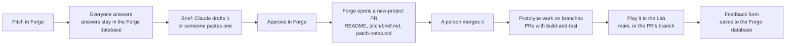
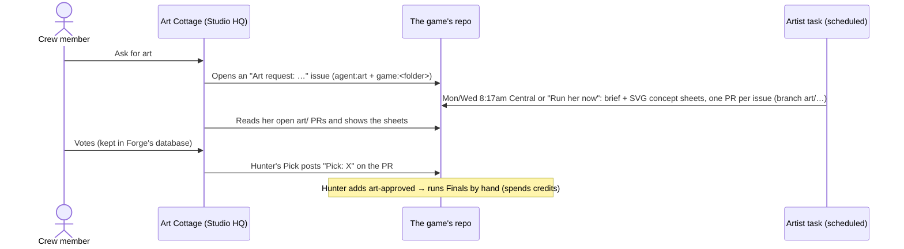

# How the JustAskJoe studio is wired

© 2026 justaskjoe. All rights reserved.

Written Oct 28, 2026, when the collective's game work moved from One Fifty Labs to the `JustAskJoe` GitHub org; updated Oct 30 for the Studio home, the GitHub suspension, the shared game list, the Producer, the private repo and the agent roster, and Oct 31 for the village's painted looks and rooms, the XR Lab, the Engineers' crew and the Artist covering every game. Tower Defense's original pitch (answers and brief) was copied into the JustAskJoe Forge on Oct 30. It describes how things run today, including the parts that still depend on Hunter's personal accounts. **Keep it current:** any pull request that changes how something here works updates this file in the same pull request (see "Keeping this doc current" at the end).

## In one paragraph

The crew's front door is **Studio HQ** (https://jaj-forge.huntefl.workers.dev), one signed-in page drawn as a village of department buildings that shows what needs someone, every game, the pitch pipeline, the agents and recent changes. It has three painted looks, and every building and agent house opens into a painted room with its agents standing in it. Game ideas start in **Forge** (`/forge` on the same site), a small website where everyone answers a pitch questionnaire on their own. When the crew approves a pitch, Forge opens a pull request that adds the game's folder to **`JustAskJoe/games`**, the public repo where all game work lives. Playable builds in that repo show up in the **Lab** (on the same site as Forge, behind the same email sign-in), including a "play this branch" link on every pull request. Art requests for any of the studio's games go to the **Artist**, a Claude agent that drafts free concept sheets as pull requests, and reports to the **Art Cottage**, a room in the village where the crew asks for art, votes on her concept sheets and Hunter makes the final pick. It works entirely through GitHub. The studio's XR apps live in a separate **private XR repo** in the same org; the village shows them in the Arcade's XR Lab for signed-in crew. GitHub is the record of truth; everything else is a view or a helper.

## In review right now (Oct 31, 2026)

These pull requests change what's described below. When one merges, move its line into the matching section and delete it here.

| PR | What changes when it merges |
| --- | --- |
| (merged and deployed Oct 30-31) | forge#4 to forge#8: the Studio home, the village, its names and the Village Engine. forge#9 to forge#11: three painted looks (Revachol, Revachol on Acid, Cozy) plus the drawn Sketch, and a painted room inside every place. forge#12 and forge#13: the **XR Lab** and the **Engineers' crew** (below), and the Artist's `art/` pull requests filed in the Art Cottage. forge#14: every Arcade cabinet in the painting opens a game. All live and described below; delete this row when this PR merges. |
| JustAskJoe/games#15 | **One game list:** `games.json` in this repo. The Lab, the Studio home and the preview links read it, so adding a game is one entry here. Fixes the "two places" gap in section 8. (Its Forge half, forge#5, is merged; until this merges the site uses its built-in list of the same games.) |
| JustAskJoe/games#16 | **Producer, stage 1:** a free weekly digest issue every Monday 8am Central (`weekly-digest.yml`, `kit/agents/digest.js`). Design and reasoning in `kit/agents/producer.md`. |
| studio-private PR #1 | **Legal reviewer** goes live in the private repo (section 5, "All agents"). |
| studio-private PR #2 | The **studio-crew plugin**: the App Engineer, Reviewer and Build Gate, packaged so any repo can install them (each repo describes itself in a `STUDIO.md` card). |

## 1. Map

| Piece | What it is | Where it lives | Runs on |
| --- | --- | --- | --- |
| **games repo** | Every game, deck, design doc and the shared kit | github.com/JustAskJoe/games (public) | GitHub, JustAskJoe org |
| **Studio HQ (the village)** | The crew's front door, drawn as a village: Town Hall, the Forge, Art Cottage, Workshop, Arcade, Town Square, and owners-only Law Office and Supply Shed, each with a live count of what's waiting on a person. Agent Lane has a house per agent. Three painted looks (pick one under the map; each browser remembers it), each with a painted room per place. In the Arcade, every painted cabinet opens a game. **Opening it** plays a short welcome (title card, then the Mayor in Town Hall with what's new), once per tab and skippable. **The Workshop is by game:** each game's pull requests and bugs, who's working on it, and **Work on this game**, which copies a ready-made first message for Claude Code (repo, folder, what to read, branch name) and marks the person as working on it (`work_now` table, `POST /api/work`, fades after a day). Every link opens in a new tab. People are named from the Worker secret `CREW_NAMES` (`email=Name,…`) | https://jaj-forge.huntefl.workers.dev (same Worker as Forge) | Same as Forge |
| **Village Engine** | The village's engine (map, Agent Lane, desks, Go inside), shared with a future Idle Hands "Home" village. Studio HQ = engine + JustAskJoe's Studio pack (`src/village.json`, scenery, rooms) | owned by One Fifty Labs: github.com/onefiftylabs/village-engine (private); copy in `JustAskJoe/forge/src/vendor/` under its `LICENSE.md` (draft, lawyer to check) | Inside the Studio HQ page |
| **Forge** | Pitch questionnaire, briefs, Approve → pull request | https://jaj-forge.huntefl.workers.dev/forge · source github.com/JustAskJoe/forge (private since Oct 30) | Cloudflare Worker `jaj-forge`, Hunter's Cloudflare account |
| **Lab** | Plays builds from the games repo, plus branch previews | https://jaj-forge.huntefl.workers.dev/lab (same Worker as Forge) | Same as Forge |
| **Forge database** | Pitches, everyone's answers, briefs, in-game feedback | Cloudflare D1 `jaj-forge` | Hunter's Cloudflare account |
| **Sign-in** | Email one-time code; only listed emails get in | Cloudflare Zero Trust (free plan), policy "Forge crew" | Hunter's Cloudflare account |
| **Art Cottage** | The Artist's room in the village: an ask box for every game in the org, her concept sets to vote on, Hunter's Pick buttons, what's waiting for her, and a **Run her now** button | Inside Studio HQ (`/api/art*` in `JustAskJoe/forge`, `src/art.js`). Moved there Oct 31; the old claude.ai page is retired | Same as Studio HQ |
| **Artist: Concepts** | Free concept sheets for art requests, for every game in the org | Scheduled task "JustAskJoe Artist: Concepts (Mon + Wed)": Mon + Wed 8:17am Central, or **Run her now** in the Art Cottage | Hunter's claude.ai plan |
| **Artist: Finals** | Final art for approved requests (spends credits) | Scheduled task "JustAskJoe Artist: Finals" (Run now only) | Hunter's claude.ai plan + PixelLab/Canva credits |
| **CI** | Build and test, secret scan, preview links, Guard | `.github/workflows/checks.yml`, `guard.yml` | GitHub Actions |
| **Producer** (in review, games#16) | Monday digest issue: reviews waiting, stuck agents, art, bugs, what merged | `.github/workflows/weekly-digest.yml` | GitHub Actions; no AI, no cost |
| **XR repo** | The studio's XR apps (headset apps), their design docs and its own copies of the Engineers' crew. Confidential: nothing from it is copied into this public repo | a private repo in the JustAskJoe org (crew access by invite) | GitHub, JustAskJoe org |
| **Private repo** | Notes and agreements that shouldn't be public, the legal reviewer, and the studio-crew plugin (in review) | github.com/JustAskJoe/studio-private (private, owners only; others added by name) | GitHub, JustAskJoe org |
| **Projects board** | Cross-repo to-do board | https://github.com/orgs/JustAskJoe/projects/1 | GitHub |
| **Org settings file** | Which org, links and ownership line Claude should use | `studio.json` in this repo | read by Claude, skills, agents |

One Fifty Labs (Hunter's own company) keeps its own website, its own Pitch Forge at onefiftylabs.co/forge, its own Lab and its own Studio HQ. Those are separate and are not part of this setup. The One Fifty Labs Lab also reads builds from this repo, so it still works, but the crew uses the JustAskJoe Lab.

## 2. How a game moves through the system



**Rules that matter:** people's raw Forge answers are never committed to Git; only the brief is. Forge never merges anything. Everything goes through a pull request.

## 3. Forge and the Lab (`JustAskJoe/forge`)

```
src/worker.js        Routes. Checks sign-in first, then: / (Studio home), /forge (Forge page),
                     /api/studio (Studio data), /api/* (Forge API), /lab and /lab/<game>[@<branch>]/ (Lab),
                     /forge/api/feedback (game feedback). Old /#p-<id> pitch links forward to /forge.
src/access.js        Verifies Cloudflare Access's signed token on every request. If sign-in isn't
                     configured, Forge refuses everyone instead of opening up.
src/forge-api.js     Pitches, answers, briefs, feedback, and /api/approve
src/github.js        Approve → creates branch forge/<game>, adds 3 files, opens the PR, adds the label
src/lab.js           Which games the Lab knows (GAMES, with names; the Studio reads it too) and how builds are fetched
src/studio.js        /api/studio: pitch counts + playtest notes from the database, open PRs, issues and commits from
                     GitHub (cached 90 s; falls back to the public repo if the token is refused), the XR Lab
                     (XR_APPS, plus open PRs and issues from the private XR repo, read with the token only),
                     and AGENTS (what each agent does, its building and its house; update it when a schedule changes)
src/village.json     The Studio pack for the Village Engine: places, Agent Lane, the painted looks, and each look's
                     Arcade cabinet boxes. Painted art (maps, streets, rooms, agent figures) is in public/art/
src/pages/studio.html The Studio home (one page, refreshes every minute): what each room shows and says, and the
                     Arcade cabinets (one game per painted cabinet; browser games, then emulator-ready XR, then
                     headset-only)
src/pages/forge.html The Forge app (one page)
src/pages/lab.html   The Lab's game list
migrations/          Database tables: pitches, answers, briefs, feedback
test/                Offline tests (npm test): sign-in checks, approve → PR, Lab routing, Studio data
```

**Settings (Cloudflare secrets; names only, values never go in Git):**

| Name | What | Needed for |
| --- | --- | --- |
| `ACCESS_TEAM_DOMAIN` | Zero Trust team domain (`broad-snowflake-c3a2.cloudflareaccess.com`) | Everything |
| `ACCESS_AUD` | The Forge Access application's audience tag | Everything |
| `GITHUB_TOKEN` | Fine-grained token "Forge (jaj-forge)", resource owner JustAskJoe: `JustAskJoe/games` (Contents + Pull requests, read and write) and the private XR repo (Pull requests + Issues, read) | Approve → PR; the village's pull requests and issues, including the XR Lab's |
| `ANTHROPIC_API_KEY` | Optional; not set | "Draft the brief with Claude" button |

`GAMES_REPO` (`JustAskJoe/games`) is a plain variable in `wrangler.toml`. `XR_REPO` can override which private repo the XR Lab reads; it isn't set.

**Deploying:** changes merge to `main` through a pull request (CI must pass), then someone with Cloudflare access runs `npx wrangler deploy` from the repo. **Merging does not deploy by itself yet.** Today only Hunter can deploy.

**Who can sign in:** Cloudflare dashboard → Zero Trust → Access controls → Policies → "Forge crew" → add or remove emails. Login methods: email one-time code (and Cloudflare account login for Hunter).

## 4. The games repo (`JustAskJoe/games`)

- **Layout:** one folder per game (`pitch/ design/ deck/ prototype/ builds/` + README + `patch-notes.md`), shared tools in `kit/`. See `CONTRIBUTING.md`.
- **Rules for Claude:** `CLAUDE.md`. Org-specific values: `studio.json`.
- **Protection ("Main" rule set):** no deleting or force-pushing `main`; every change is a pull request; required checks **Build and test** and **Guard**.
- **Guard** (`guard.yml`) fails a PR that deletes builds, `pitch/`, `handoff.md`, patch notes, `kit/` or the top-level docs, or that edits `.github/` or `CLAUDE.md`, until someone other than the author approves it.
- **Checks** (`checks.yml`) scans for secrets, runs Tower Defense's build-and-test when that game, `kit/` or CI changes, and posts "Play this branch" links (base address from the `LAB_URL` repo variable).
- **Access:** the **games** team (write) in the JustAskJoe org. Org owners: Hunter (`onefiftylabs`) and Zach (`savagezcs`). Org members get **no access by default** (set Oct 30), so a private repo is visible only to owners and people added to it by name.
- **Labels:** one `game:<folder>` per game; `agent:art`, `art:review`, `art-approved`, `art:done`, `needs-human` (the Artist's state machine); `new-project` (Forge approvals); `playtest`, `pitch`.
- **Templates:** issue forms (Bug in a game, Art request) and a PR checklist in `.github/`.
- **Co-op server** (`tower-defense/server/`): runs locally only (`npm start`); not deployed anywhere yet.

## 5. The Artist and the Art Cottage



- **Instructions:** `kit/agents/artist.md` in this repo for this repo's games (the XR repo has its own copy), plus each game's `art/art-direction.md`. Since Oct 31 the Concepts prompt's `PROJECTS:` lists every game in the org: the five here and the XR repo's apps. A game with no `art/art-direction.md` yet gets a draft one in its first concepts pull request, for the crew to review. Nothing from the private XR repo is ever copied here.
- **Concepts task:** Mon + Wed 8:17am Central, plus **Run her now** in the Art Cottage (anyone signed in; once per 15 minutes for the whole crew). The button uses the task's API trigger; its key is the Worker secret `ARTIST_RUN_TOKEN` and can start only this task. Connectors: Canva, Slack, Claude Code Remote. **No PixelLab**, so it cannot spend credits.
- **Finals task:** no schedule, Run now only. Connectors: PixelLab, Canva, Slack. Acts only on issues labeled `art-approved` and stops if over the estimate. Its prompt still lists Tower Defense only.
- **How the Art Cottage works** (moved from a claude.ai page into Studio HQ on Oct 31, because the Artist's scheduled runs couldn't reach that page's data): it's **game-first**: you pick a game (or arrive from a game's "Ask the Artist" button, or `/?art=<slug>`), and the room shows only that game's sets, waiting requests and ask box, with nothing pre-selected. Everything goes through GitHub. A request is an issue labeled `agent:art` + `game:<folder>` in the game's own repo (10 a day per person). A concept set is one of her open pull requests on an `art/…` branch, with sheets at `<folder>/art/concepts/<issue>-<A|B|C>.svg` and labels from the brief's `- A: Label: blurb` lines. Votes are kept in Forge's database (`art_votes`). Only emails in the Worker secret `ART_PICKERS` (Hunter) see the Pick buttons; a pick is a "Pick: X" comment on the pull request. The Studio's GitHub key needs Issues: write for requests and picks.
- **Adding a game to the Artist:** nothing to do for a browser game: the Concepts prompt and the Art Cottage both read `games.json`, which Forge's Approve adds new games to. An XR app goes in `XR_APPS` in `JustAskJoe/forge` and in the task prompts. The Artist drafts `art/art-direction.md` on its first request if it has none, and GitHub creates the `game:<folder>` label the first time she uses it.

### All agents (Oct 31, 2026)

| Agent | Kind | Status | When it runs |
| --- | --- | --- | --- |
| Artist: Concepts | Claude, scheduled task | Live | Mon + Wed 8:17am Central, or Run her now in the Art Cottage |
| Artist: Finals | Claude, scheduled task | Live | Run now only (spends credits) |
| Guard, Checks | GitHub Actions, no AI | Live | Every pull request |
| Producer | GitHub Actions, no AI (stage 1) | In review (games#16) | Monday 8am Central |
| Legal reviewer | Claude Code agent (`.claude/agents/legal-reviewer.md` in `studio-private`) | In review (studio-private PR #1) | When someone asks; first-pass review of an agreement, 🟢/🟡/🔴; not a lawyer, never signs |
| Lead Artist | Claude Code agent (`kit/agents/lead-artist.md`) | Planned (games#38) | On demand, one game at a time: writes `<game>/art/lead-plan.md`, reviews art sets, keeps `kit/art/art-rules.md` and `kit/art/lessons.md`; never makes images or spends |
| App Engineer, Reviewer, Build Gate ("the Engineers") | Claude Code agents (`.claude/agents/` in the XR repo; the studio-crew plugin in review for every repo) | Live | In a Claude Code session, when someone asks. Each reads the repo's `STUDIO.md` card. The Engineer builds with tests and never commits; the Reviewer reviews and never edits; the Build Gate runs every check and commits only on a pass |
| SDK Librarian, Headset test partner | Designed in the XR team plan (studio-private) | Planned | On demand |
| Playtester, Balance | Not designed yet | Planned | Probably on-demand Claude Code agents, like the legal reviewer |

## 6. Accounts and who controls what

| Account | Owner | Holds |
| --- | --- | --- |
| GitHub org `JustAskJoe` | Hunter and Zach (owners); crew via the **games** team | games (public), forge (private; team access); studio-private (owners only) |
| GitHub account `onefiftylabs` | Hunter (One Fifty Labs) | village-engine (private), plus One Fifty Labs' own repos |
| Cloudflare | Hunter's personal account | Forge + Lab Worker, Forge database, sign-in |
| claude.ai | Hunter's personal account | Both Artist tasks, the skills |
| Canva, PixelLab | Hunter | Art credits (ask before spending) |
| Everyone's own Claude | Each person | Day-to-day work in this repo |

This is fine for now ("Where do the shared accounts live?" in HOW-WE-WORK). It matters if Hunter is unavailable, for who pays, and before a game is sold.

## 7. What the crew can and can't do today

**Can:** sign in to Forge and the Lab (if on the list), pitch, answer, paste briefs, approve pitches, push branches and open PRs, review and approve each other's PRs (needed for Guard), file art requests for any game (GitHub issue with `agent:art` + `game:<folder>`, or the Art Cottage ask box), start the Artist with Run her now, vote on art, play every browser game from its Arcade cabinet, and try the emulator-ready XR apps on the headset maker's free emulator (the Arcade links each one's test guide; headset testing is Hunter's for now).

**Zach, as an org owner, can also:** manage GitHub members, teams, repo settings and rules, so the org keeps running if Hunter's account is unavailable.

**Can't (only Hunter, today):** deploy Forge/Lab changes, add people to the sign-in list, make the final art pick, run Finals, spend art credits, change Cloudflare or claude.ai settings.

## 8. Known gaps and risks

- **Single owner outside GitHub.** Cloudflare, claude.ai and art credits are Hunter's personal accounts (section 6). GitHub now has two owners.
- **GitHub suspensions happen.** Hunter's account (created Oct 19) was suspended by GitHub's automated abuse detection Oct 28-30, 2026, right after a burst of automated setup (org transfer, teams, invites, rules, many branches and PRs). GitHub gave no specific reason and cleared it on appeal. While suspended, his PRs were hidden and Forge's `GITHUB_TOKEN` (made on his account) stopped working, so Approve could not open PRs. To lower the risk: spread bulk GitHub changes out, turn on two-factor sign-in, and move Forge to a GitHub App owned by the org instead of a personal token.
- **Forge doesn't auto-deploy.** Merging a Forge PR changes nothing live until someone runs `npx wrangler deploy`.
- **The Lab's game list is hardcoded in two places:** `GAMES` in `forge/src/lab.js` (+ a card in `lab.html`) and the `LAB` map in this repo's `checks.yml` (preview links). They can drift.
- **Free painted roughs** (open PR #11) would call an endpoint on the One Fifty Labs website and need an `ART_KEY` secret here.
- **The deck and prototype kit also exist in Hunter's claude.ai Project "AI Games".** The repo's `kit/` is the copy the crew uses; the two can drift.
- **The Artist has no automated tests.** Each real run is the test.
- **The XR Lab depends on the token.** If `GITHUB_TOKEN` loses access to the private XR repo, the Workshop says so and the XR pull requests disappear; nothing else breaks.
- **Agents that share a house share a figure.** The village draws one painted character per house, so the four Engineers look alike until each gets their own art.

## 9. How to change things

| I want to... | Do this |
| --- | --- |
| Add a person | Hunter: invite their GitHub username to the **games** team; add their email to the "Forge crew" policy. Point them (and their Claude) at `ONBOARDING.md`. They don't see `studio-private` unless an owner adds them there (repo Settings → Collaborators and teams). |
| Review an agreement before signing | In `studio-private`: put it in `legal/agreements/`, then ask Claude Code "Use the legal-reviewer agent on <file>. It's for: <one line>." See `legal/README.md` there for when a real lawyer is needed. |
| Add a game to the Lab | After games#15 and forge#5: one entry in `games.json` here, nothing else. Until then: PR in `JustAskJoe/forge`: one line in `GAMES` (`src/lab.js`) and a card in `src/pages/lab.html`; deploy. PR here: add it to the `LAB` map in `.github/workflows/checks.yml` (Guard needs a second approver). |
| Change Forge or the Lab | Branch + PR in `JustAskJoe/forge`, `npm test` and `npm run check` pass, merge, deploy. |
| Change what the Studio says about an agent | Edit `AGENTS` in `forge/src/studio.js`, PR, deploy. |
| Put a game on an Arcade cabinet | Nothing: cabinets fill in order (browser games, then emulator-ready XR, then headset-only). A look with more cabinets than games leaves the rest dark; new cabinets need new boxes in `src/village.json`. |
| Add an XR app to the XR Lab | One entry in `XR_APPS` (`forge/src/studio.js`, with `emulator: true` only if its test guide says it runs on the emulator), PR, deploy. |
| If a GitHub account is suspended | The owner appeals at support.github.com ("reinstatement request"). Meanwhile the other org owner keeps the org running; Forge and the Lab stay up (Cloudflare), but Approve can't open PRs if the token belongs to the suspended account. |
| Rotate the GitHub token | Make a new fine-grained token (same scope), paste it as the `GITHUB_TOKEN` secret on `jaj-forge`, delete the old one on GitHub. |
| Add an agent (Producer, Playtester...) | Write `kit/agents/<role>.md`, create its labels, create its scheduled task(s) with only the connectors it needs, add it to `AGENTS` in `JustAskJoe/forge` so it gets a place in Studio HQ (the village), and document it here. |

## Keeping this doc current

- **Same pull request rule:** if a PR changes how a piece in this doc works (a new route, a new secret, a new agent, a new account, a changed schedule), it updates this file too. Claude is told to do this in `CLAUDE.md`.
- **Who checks:** whoever reviews the PR. If the description no longer matches reality, ask for the update before approving.
- **Quarterly skim:** at a check-in, someone reads sections 1, 6 and 8 and fixes anything stale.
