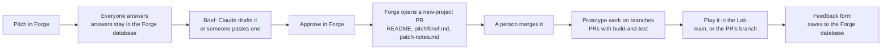

# How the JustAskJoe studio is wired

© 2026 justaskjoe. All rights reserved.

Written Oct 28, 2026, when the collective's game work moved from One Fifty Labs to the `JustAskJoe` GitHub org; updated Oct 30 for the Studio home, the GitHub suspension, the shared game list, the Producer, the private repo and the agent roster. Tower Defense's original pitch (answers and brief) was copied into the JustAskJoe Forge on Oct 30. It describes how things run today, including the parts that still depend on Hunter's personal accounts. **Keep it current:** any pull request that changes how something here works updates this file in the same pull request (see "Keeping this doc current" at the end).

## In one paragraph

The crew's front door is the **Studio** home (https://jaj-forge.huntefl.workers.dev), one signed-in page that shows what needs someone, every game, the pitch pipeline, the agents and recent changes. Game ideas start in **Forge** (`/forge` on the same site), a small website where everyone answers a pitch questionnaire on their own. When the crew approves a pitch, Forge opens a pull request that adds the game's folder to **`JustAskJoe/games`**, the public repo where all game work lives. Playable builds in that repo show up in the **Lab** (on the same site as Forge, behind the same email sign-in), including a "play this branch" link on every pull request. Art requests go to the **Artist**, a Claude agent that runs on a schedule, drafts free concept sheets as pull requests, and reports to **Studio HQ**, a claude.ai page where the crew picks and votes. GitHub is the record of truth; everything else is a view or a helper.

## In review right now (Oct 30, 2026)

These pull requests change what's described below. When one merges, move its line into the matching section and delete it here.

| PR | What changes when it merges |
| --- | --- |
| JustAskJoe/forge#4 | **Studio home** at `/`, Forge moves to `/forge` (section 3 already describes this). Needs a deploy after merging. |
| JustAskJoe/games#15 + JustAskJoe/forge#5 | **One game list:** `games.json` in this repo. The Lab, the Studio home and the preview links read it, so adding a game is one entry here. Fixes the "two places" gap in section 8. |
| JustAskJoe/games#16 | **Producer, stage 1:** a free weekly digest issue every Monday 8am Central (`weekly-digest.yml`, `kit/agents/digest.js`). Design and reasoning in `kit/agents/producer.md`. |
| studio-private PR #1 | **Legal reviewer** goes live in the private repo (section 5, "All agents"). |

## 1. Map

| Piece | What it is | Where it lives | Runs on |
| --- | --- | --- | --- |
| **games repo** | Every game, deck, design doc and the shared kit | github.com/JustAskJoe/games (public) | GitHub, JustAskJoe org |
| **Studio home** | The crew's front door: Pitch / Play / Agents, what needs someone, games, pitches, agents, recent commits | https://jaj-forge.huntefl.workers.dev (same Worker as Forge) | Same as Forge |
| **Forge** | Pitch questionnaire, briefs, Approve → pull request | https://jaj-forge.huntefl.workers.dev/forge · source github.com/JustAskJoe/forge (public) | Cloudflare Worker `jaj-forge`, Hunter's Cloudflare account |
| **Lab** | Plays builds from the games repo, plus branch previews | https://jaj-forge.huntefl.workers.dev/lab (same Worker as Forge) | Same as Forge |
| **Forge database** | Pitches, everyone's answers, briefs, in-game feedback | Cloudflare D1 `jaj-forge` | Hunter's Cloudflare account |
| **Sign-in** | Email one-time code; only listed emails get in | Cloudflare Zero Trust (free plan), policy "Forge crew" | Hunter's Cloudflare account |
| **Studio HQ** | The Artist's desk, art inbox, picks and votes, ask box | https://claude.ai/artifact/BcRVpMGrpV3JKJzPSPBLqb | Hunter's claude.ai account |
| **Artist: Concepts** | Free concept sheets for art requests | Scheduled task "JustAskJoe Artist: Concepts (Mon + Wed)" | Hunter's claude.ai plan |
| **Artist: Finals** | Final art for approved requests (spends credits) | Scheduled task "JustAskJoe Artist: Finals" (Run now only) | Hunter's claude.ai plan + PixelLab/Canva credits |
| **CI** | Build and test, secret scan, preview links, Guard | `.github/workflows/checks.yml`, `guard.yml` | GitHub Actions |
| **Producer** (in review, games#16) | Monday digest issue: reviews waiting, stuck agents, art, bugs, what merged | `.github/workflows/weekly-digest.yml` | GitHub Actions; no AI, no cost |
| **Private repo** | Notes and agreements that shouldn't be public, and the legal reviewer | github.com/JustAskJoe/studio-private (private, owners only; others added by name) | GitHub, JustAskJoe org |
| **Projects board** | Cross-repo to-do board | https://github.com/orgs/JustAskJoe/projects/1 | GitHub |
| **Org settings file** | Which org, links and ownership line Claude should use | `studio.json` in this repo | read by Claude, skills, agents |

One Fifty Labs (Hunter's own company) keeps its own website, its own Pitch Forge at onefiftylabs.co/forge, its own Lab and its own Studio HQ. Those are separate and are not part of this setup. The One Fifty Labs Lab also reads builds from this repo, so it still works, but the crew uses the JustAskJoe Lab.

## 2. How a game moves through the system



**Rules that matter:** people's raw Forge answers are never committed to Git; only the brief is. Forge never merges anything. Everything goes through a pull request.

## 3. Forge and the Lab (`JustAskJoe/forge`)

```
src/worker.js        Routes. Checks sign-in first, then: / (Studio home), /forge (Forge page),
                     /api/studio (Studio data), /api/* (Forge API), /lab and /lab/<game>[@<branch>]/ (Lab),
                     /forge/api/feedback (game feedback). Old /#p-<id> pitch links forward to /forge.
src/access.js        Verifies Cloudflare Access's signed token on every request. If sign-in isn't
                     configured, Forge refuses everyone instead of opening up.
src/forge-api.js     Pitches, answers, briefs, feedback, and /api/approve
src/github.js        Approve → creates branch forge/<game>, adds 3 files, opens the PR, adds the label
src/lab.js           Which games the Lab knows (GAMES, with names; the Studio reads it too) and how builds are fetched
src/studio.js        /api/studio: pitch counts + playtest notes from the database, open PRs, issues and commits from
                     GitHub (cached 90 s; falls back to the public repo if the token is refused), and AGENTS
                     (what each agent does and when it runs; update it when a schedule changes in Studio HQ)
src/pages/studio.html The Studio home (one page, refreshes every minute)
src/pages/forge.html The Forge app (one page)
src/pages/lab.html   The Lab's game list
migrations/          Database tables: pitches, answers, briefs, feedback
test/                Offline tests (npm test): sign-in checks, approve → PR, Lab routing, Studio data
```

**Settings (Cloudflare secrets; names only, values never go in Git):**

| Name | What | Needed for |
| --- | --- | --- |
| `ACCESS_TEAM_DOMAIN` | Zero Trust team domain (`broad-snowflake-c3a2.cloudflareaccess.com`) | Everything |
| `ACCESS_AUD` | The Forge Access application's audience tag | Everything |
| `GITHUB_TOKEN` | Fine-grained token: `JustAskJoe/games` only, Contents + Pull requests (read and write) | Approve → PR |
| `ANTHROPIC_API_KEY` | Optional; not set | "Draft the brief with Claude" button |

`GAMES_REPO` (`JustAskJoe/games`) is a plain variable in `wrangler.toml`.

**Deploying:** changes merge to `main` through a pull request (CI must pass), then someone with Cloudflare access runs `npx wrangler deploy` from the repo. **Merging does not deploy by itself yet.** Today only Hunter can deploy.

**Who can sign in:** Cloudflare dashboard → Zero Trust → Access controls → Policies → "Forge crew" → add or remove emails. Login methods: email one-time code (and Cloudflare account login for Hunter).

## 4. The games repo (`JustAskJoe/games`)

- **Layout:** one folder per game (`pitch/ design/ deck/ prototype/ builds/` + README + `patch-notes.md`), shared tools in `kit/`. See `CONTRIBUTING.md`.
- **Rules for Claude:** `CLAUDE.md`. Org-specific values: `studio.json`.
- **Protection ("Main" rule set):** no deleting or force-pushing `main`; every change is a pull request; required checks **Build and test** and **Guard**.
- **Guard** (`guard.yml`) fails a PR that deletes builds, `pitch/`, `handoff.md`, patch notes, `kit/` or the top-level docs, or that edits `.github/` or `CLAUDE.md`, until someone other than the author approves it.
- **Checks** (`checks.yml`) scans for secrets, runs Tower Defense's build-and-test when that game, `kit/` or CI changes, and posts "Play this branch" links (base address from the `LAB_URL` repo variable).
- **Access:** the **games** team (write) in the JustAskJoe org. Org owners: Hunter (`onefiftylabs`) and Zach (`savagezcs`). Org members get **no access by default** (set Oct 30), so a private repo is visible only to owners and people added to it by name.
- **Labels:** one `game:<folder>` per game; `agent:art`, `art:review`, `art-approved`, `art:done`, `needs-human` (the Artist's state machine); `new-project` (Forge approvals); `playtest`, `pitch`.
- **Templates:** issue forms (Bug in a game, Art request) and a PR checklist in `.github/`.
- **Co-op server** (`tower-defense/server/`): runs locally only (`npm start`); not deployed anywhere yet.

## 5. The Artist and Studio HQ

```mermaid
sequenceDiagram
  actor P as Crew member
  participant HQ as Studio HQ (claude.ai)
  participant T as Artist task (scheduled)
  participant GH as JustAskJoe/games
  P->>HQ: Ask for art (queued) or Hunter clicks "Send"/"Wake"
  T->>HQ: Reads queued requests (Mon/Wed 8:17am Central, or when woken)
  T->>GH: Opens an issue, writes brief + SVG concept sheets, opens a PR
  T->>HQ: Posts the options to the inbox, updates the desk and log
  P->>HQ: Votes; Hunter sends the pick
  T->>GH: Posts "Pick: X" on the PR
  Note over GH: Hunter adds art-approved → runs Finals by hand (spends credits)
```

- **Instructions:** `kit/agents/artist.md` in this repo, plus each game's `art/art-direction.md`. The task prompts say `PROJECTS: JustAskJoe/games:tower-defense`.
- **Concepts task:** scheduled Mon + Wed 8:17am Central. Connectors: Canva, Slack, Claude Code Remote. **No PixelLab**, so it cannot spend credits.
- **Finals task:** no schedule, Run now only. Connectors: PixelLab, Canva, Slack. Acts only on issues labeled `art-approved` and stops if over the estimate.
- **Studio HQ data** (the page's own database): `desks` (the Artist's status), `inbox` (things to pick), `requests` (crew asks), `log`, `votes`. Crew members with "can use" access can ask and vote; only Hunter can wake the Artist or send picks, because those buttons use his claude.ai account.
- **Adding a game to the Artist:** add `art/art-direction.md` and `design/ai-assets.md` to the game, make sure its `game:<folder>` label exists, add it to `PROJECTS:` in both task prompts, and add it to HQ's game list (page code).

### All agents (Oct 30, 2026)

| Agent | Kind | Status | When it runs |
| --- | --- | --- | --- |
| Artist: Concepts | Claude, scheduled task | Live | Mon + Wed 8:17am Central |
| Artist: Finals | Claude, scheduled task | Live | Run now only (spends credits) |
| Guard, Checks | GitHub Actions, no AI | Live | Every pull request |
| Producer | GitHub Actions, no AI (stage 1) | In review (games#16) | Monday 8am Central |
| Legal reviewer | Claude Code agent (`.claude/agents/legal-reviewer.md` in `studio-private`) | In review (studio-private PR #1) | When someone asks; first-pass review of an agreement, 🟢/🟡/🔴; not a lawyer, never signs |
| Engineer, Playtester, Balance | Not designed yet | Planned | Probably on-demand Claude Code agents, like the legal reviewer |

## 6. Accounts and who controls what

| Account | Owner | Holds |
| --- | --- | --- |
| GitHub org `JustAskJoe` | Hunter and Zach (owners); crew via the **games** team | games, forge (team access); studio-private (owners only) |
| Cloudflare | Hunter's personal account | Forge + Lab Worker, Forge database, sign-in |
| claude.ai | Hunter's personal account | Studio HQ, both Artist tasks, the skills |
| Canva, PixelLab | Hunter | Art credits (ask before spending) |
| Everyone's own Claude | Each person | Day-to-day work in this repo |

This is fine for now ("Where do the shared accounts live?" in HOW-WE-WORK). It matters if Hunter is unavailable, for who pays, and before a game is sold.

## 7. What the crew can and can't do today

**Can:** sign in to Forge and the Lab (if on the list), pitch, answer, paste briefs, approve pitches, push branches and open PRs, review and approve each other's PRs (needed for Guard), file art requests (GitHub issue with `agent:art` + `game:<folder>`, or the Studio HQ ask box), vote on art.

**Zach, as an org owner, can also:** manage GitHub members, teams, repo settings and rules, so the org keeps running if Hunter's account is unavailable.

**Can't (only Hunter, today):** deploy Forge/Lab changes, add people to the sign-in list, wake the Artist or send picks from Studio HQ, run Finals, spend art credits, change Cloudflare or claude.ai settings.

## 8. Known gaps and risks

- **Single owner outside GitHub.** Cloudflare, claude.ai and art credits are Hunter's personal accounts (section 6). GitHub now has two owners.
- **GitHub suspensions happen.** Hunter's account (created Oct 19) was suspended by GitHub's automated abuse detection Oct 28-30, 2026, right after a burst of automated setup (org transfer, teams, invites, rules, many branches and PRs). GitHub gave no specific reason and cleared it on appeal. While suspended, his PRs were hidden and Forge's `GITHUB_TOKEN` (made on his account) stopped working, so Approve could not open PRs. To lower the risk: spread bulk GitHub changes out, turn on two-factor sign-in, and move Forge to a GitHub App owned by the org instead of a personal token.
- **Forge doesn't auto-deploy.** Merging a Forge PR changes nothing live until someone runs `npx wrangler deploy`.
- **The Lab's game list is hardcoded in two places:** `GAMES` in `forge/src/lab.js` (+ a card in `lab.html`) and the `LAB` map in this repo's `checks.yml` (preview links). They can drift.
- **Free painted roughs** (open PR #11) would call an endpoint on the One Fifty Labs website and need an `ART_KEY` secret here.
- **The deck and prototype kit also exist in Hunter's claude.ai Project "AI Games".** The repo's `kit/` is the copy the crew uses; the two can drift.
- **The Artist has no automated tests.** Each real run is the test.

## 9. How to change things

| I want to... | Do this |
| --- | --- |
| Add a person | Hunter: invite their GitHub username to the **games** team; add their email to the "Forge crew" policy; share Studio HQ with them ("can use"). They don't see `studio-private` unless an owner adds them there (repo Settings → Collaborators and teams). |
| Review an agreement before signing | In `studio-private`: put it in `legal/agreements/`, then ask Claude Code "Use the legal-reviewer agent on <file>. It's for: <one line>." See `legal/README.md` there for when a real lawyer is needed. |
| Add a game to the Lab | After games#15 and forge#5: one entry in `games.json` here, nothing else. Until then: PR in `JustAskJoe/forge`: one line in `GAMES` (`src/lab.js`) and a card in `src/pages/lab.html`; deploy. PR here: add it to the `LAB` map in `.github/workflows/checks.yml` (Guard needs a second approver). |
| Change Forge or the Lab | Branch + PR in `JustAskJoe/forge`, `npm test` and `npm run check` pass, merge, deploy. |
| Change what the Studio says about an agent | Edit `AGENTS` in `forge/src/studio.js`, PR, deploy. |
| If a GitHub account is suspended | The owner appeals at support.github.com ("reinstatement request"). Meanwhile the other org owner keeps the org running; Forge and the Lab stay up (Cloudflare), but Approve can't open PRs if the token belongs to the suspended account. |
| Rotate the GitHub token | Make a new fine-grained token (same scope), paste it as the `GITHUB_TOKEN` secret on `jaj-forge`, delete the old one on GitHub. |
| Add an agent (Producer, Playtester...) | Write `kit/agents/<role>.md`, create its labels, create its scheduled task(s) with only the connectors it needs, add a desk to Studio HQ, and document it here. |

## Keeping this doc current

- **Same pull request rule:** if a PR changes how a piece in this doc works (a new route, a new secret, a new agent, a new account, a changed schedule), it updates this file too. Claude is told to do this in `CLAUDE.md`.
- **Who checks:** whoever reviews the PR. If the description no longer matches reality, ask for the update before approving.
- **Quarterly skim:** at a check-in, someone reads sections 1, 6 and 8 and fixes anything stale.
